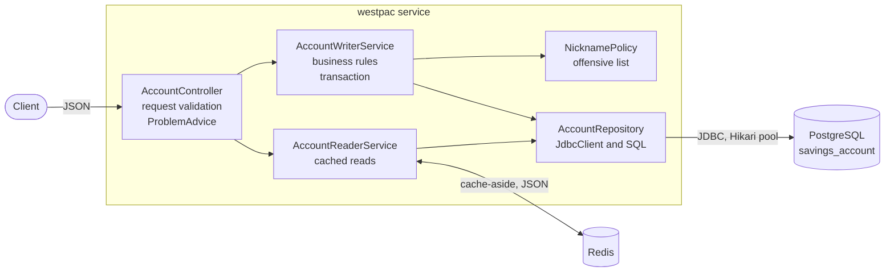
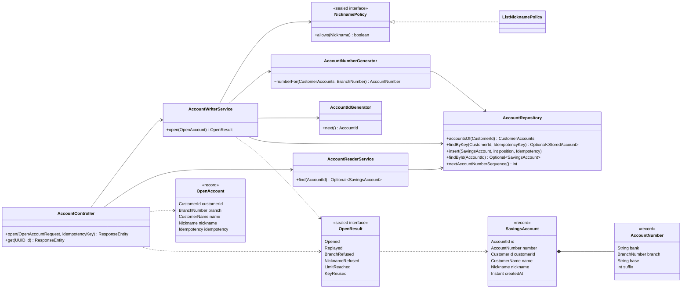
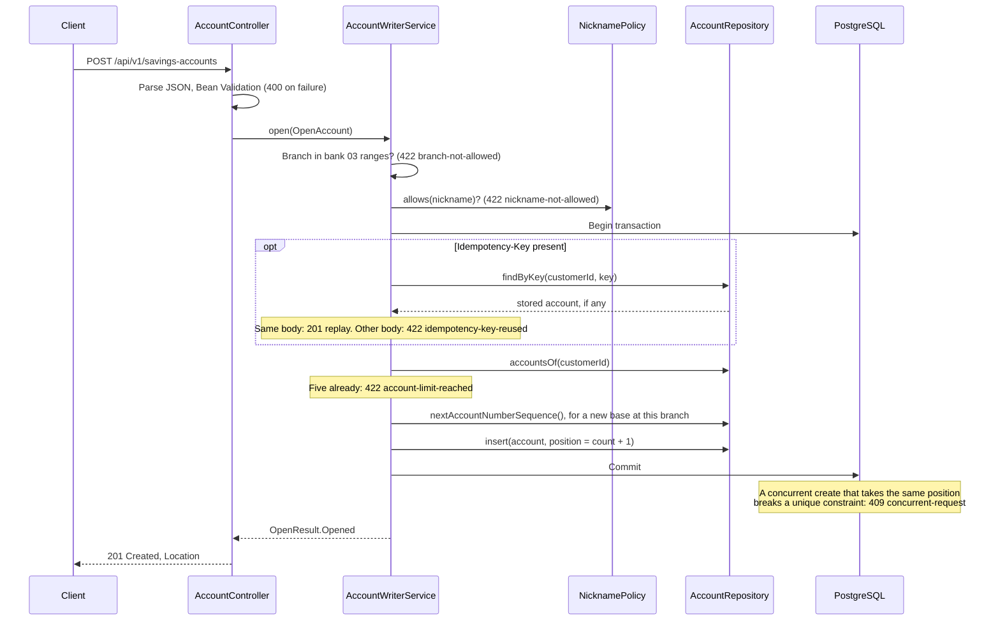
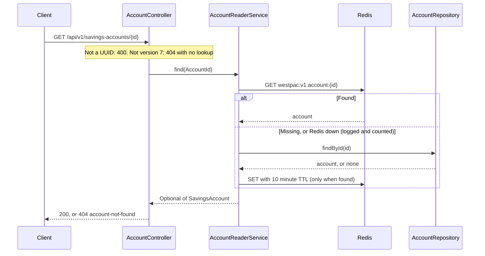

# Savings Account API

A Spring Boot service that opens savings bank accounts and reads them back. It stores the accounts in
PostgreSQL, in one table, and caches reads in Redis.

> [!TIP]
> **The quick way: use a coding agent.** Clone the repository, go into its folder, and start Claude
> Code, Codex or another agent that reads `AGENTS.md`. An agent speaks only after a message, so start it
> with one, for example `claude "hello"` or `codex "hello"`. The agent explains the system, offers
> to deploy it, runs the smoke test, and sends requests for you. Ask it, for example:
>
> - "Deploy the system and run the smoke test."
> - "Open an account for Jane Citizen with the nickname Rainy Day Fund."
> - "Show me the five-account limit."
>
> To do it by hand, follow [section 1](#1-run-it-from-a-clean-clone).

Contents:

1. [Run it from a clean clone](#1-run-it-from-a-clean-clone)
2. [Project layout](#2-project-layout)
3. [How the service meets the requirements](#3-how-the-service-meets-the-requirements)
4. [Decisions and the alternatives](#4-decisions-and-the-alternatives)
5. [TODO](#5-todo)

---

## 1. Run it from a clean clone

**You need** Docker with Compose 2.20 or later, `make`, `bash`, `curl` and `uuidgen`. The image
builds the jar itself, so this procedure needs no Java on the host.

```bash
git clone git@github.com:causecelebre/westpac.git
cd westpac
make env      # copy .env.example to .env (local passwords only)
make up       # build the image, start PostgreSQL, Redis and the service, wait until ready
make smoke    # create an account, read it back, and check one refusal
```

**If a port is in use.** The host ports come from `.env`: `APP_PORT` (8080), `MANAGEMENT_PORT`
(8081), `DB_PORT` (5432) and `REDIS_PORT` (6379). Change the value in `.env` before `make up`.
`make smoke` reads `APP_PORT` from `.env`. In the `curl` examples below, change 8080 to the same value.

`make smoke` prints one line for each check that passes:

```text
ok: create gave 201 and /api/v1/savings-accounts/<id>
ok: read gave 200 and the same body
ok: branch 2000 gave 422 branch-not-allowed
```

To send a request yourself:

```bash
curl -i -H 'Content-Type: application/json' \
  -H "Idempotency-Key: $(uuidgen)" \
  -d '{"customerId":"7d3f9c2a-5b1e-4f6a-8c0d-2e9b4a7f1c35","branch":"0123",
       "customerName":"Jane Citizen","nickname":"Rainy Day Fund"}' \
  http://127.0.0.1:8080/api/v1/savings-accounts

curl -i http://127.0.0.1:8080/api/v1/savings-accounts/<id from the Location header>
```

To stop, use `make down`. The data volume stays. To delete the data too, use `make reset`.

**Other ways to run it.** These need a JDK 25 on the host.

| Command | The service runs | PostgreSQL and Redis run |
| --- | --- | --- |
| `make run` | On the host, through `./gradlew bootRun` | In Docker |
| `make run-direct` | On the host, through `./gradlew bootRun` | Where `.env` points |
| `make check` | Format, style, Error Prone, SpotBugs and all tests. The tests start their own containers through Testcontainers | - |

The API is on `APP_PORT`. Health, info and Prometheus metrics are on `MANAGEMENT_PORT`. In Docker
the service listens on 8080 and 8081 inside the container, and Compose does not publish the
management port to the host.

---

## 2. Project layout

```text
.
├── build.gradle, settings.gradle
├── gradle/libs.versions.toml           every version, pinned
├── config/                             Checkstyle, SpotBugs and licence header
├── compose.yaml                        postgres, redis, and app (profile "app")
├── Dockerfile                          two stages: build the jar, run it as layers
├── Makefile                            one target for each arrangement
├── .env.example                        local values for .env
├── docker/postgres/init/               creates the two database roles and the schema
├── docker/smoke.sh                     the smoke test
└── src/
    ├── main/
    │   ├── java/nz/co/bitmonkey/westpac/
    │   │   ├── account/                domain types, AccountWriterService, AccountReaderService,
    │   │   │                           OpenResult, AccountIdGenerator, AccountNumberGenerator, Bank03
    │   │   ├── account/web/            AccountController, request and response records, @CodePoints
    │   │   ├── account/store/          AccountRepository
    │   │   ├── moderation/             NicknamePolicy, ListNicknamePolicy, NicknameNormaliser
    │   │   ├── web/                    Problem, ProblemAdvice, FieldErrorCode, RequestIdFilter
    │   │   └── config/                 properties records, cache, security, clock
    │   └── resources/
    │       ├── application.yml
    │       ├── db/migration/V1__savings_account.sql
    │       └── moderation/offensive-nicknames.txt
    └── test/java/nz/co/bitmonkey/westpac/...
```

---

## 3. How the service meets the requirements

### 3.1 The API

| Request | Answer |
| --- | --- |
| `POST /api/v1/savings-accounts` with `customerId`, `branch`, `customerName` and an optional `nickname`. An optional `Idempotency-Key` header | `201`, a `Location` header and the account |
| `GET /api/v1/savings-accounts/{id}` | `200` and the account, or `404` |

```json
{
  "id": "01936b2e-7c4a-7f3d-9a51-2c8e4b6d1f00",
  "accountNumber": "03-0123-0000019-000",
  "customerId": "7d3f9c2a-5b1e-4f6a-8c0d-2e9b4a7f1c35",
  "customerName": "Jane Citizen",
  "nickname": "Rainy Day Fund",
  "createdAt": "2026-11-24T02:15:30.123Z"
}
```

Each error is an RFC 9457 Problem Details body with a stable `code` and the `requestId`.

| Status | `code` |
| --- | --- |
| 400 | `malformed-request`, `validation-failed` (lists each field that fails) |
| 404 | `account-not-found` |
| 409 | `concurrent-request`. A retry with the same `Idempotency-Key` is safe |
| 413, 415 | `request-too-large`, `unsupported-media-type` |
| 422 | `branch-not-allowed`, `nickname-not-allowed`, `account-limit-reached`, `idempotency-key-reused` |
| 503 | `service-unavailable`, with `Retry-After` |
| 500 | `internal-error`. The log has the full fault. The body has only the code |

### 3.2 Each requirement

| Requirement | How the service meets it | Tests |
| --- | --- | --- |
| Create a savings account | `AccountController` calls `AccountWriterService.open`, which returns a sealed `OpenResult` | `CreateAndReadTest` |
| Get a savings account | `AccountController` calls `AccountReaderService.find` by id | `CreateAndReadTest` |
| Validate the request body | Strict JSON: no unknown properties, no duplicate keys, 4 KiB at most. Bean Validation on `OpenAccountRequest`. The domain types check again in their constructors | `RequestRulesTest`, `FieldRulesTest`, `RequestSizeTest` |
| Account number generated by the API | `AccountNumberGenerator` makes a New Zealand account number for bank `03`, with a valid check digit. A PostgreSQL sequence gives the account base | `AccountNumberTest`, `AccountNumberGeneratorTest` |
| Id generated by the API | `AccountIdGenerator` makes a UUID version 7 from a `SecureRandom` | `AccountIdGeneratorTest`, `AccountIdTest` |
| Customer name mandatory | `@NotNull` and `@CodePoints(min = 1, max = 100)` on the request refuse a missing or blank value. 1 to 100 letters, with space, hyphen, apostrophe and full stop | `CustomerNameTest`, `FieldRulesTest` |
| Nickname optional, 5 to 30 characters | `@CodePoints(min = 5, max = 30)` counts Unicode code points after trimming. `Nickname` and a check constraint in the table repeat the rule | `NicknameTest`, `FieldRulesTest`, `SchemaBackstopsTest` |
| No more than 5 accounts per customer | Each row has a position from 1 to 5 for its customer, with `unique (customer_id, customer_account_seq)`. The table cannot hold a sixth account, also under concurrent creates | `CreateAndReadTest`, `ConcurrentLimitTest`, `ConflictTest`, `CustomerAccountLimitTest` |
| Nickname checked against an offensive list | `ListNicknamePolicy` reads `offensive-nicknames.txt` at startup. It folds case, accents and digit substitutions, then matches each word and all words joined | `ListNicknamePolicyTest`, `ListNicknamePolicyStartTest` |
| PostgreSQL, one table | `V1__savings_account.sql` makes `savings_account`. `AccountRepository` uses `JdbcClient` with named parameters | `AccountRepositoryTest`, `PrivilegesTest`, `SchemaBackstopsTest` |
| Optional: database unavailable | Short connection, statement and lock timeouts. `ProblemAdvice` turns each database fault into `503` with `Retry-After`. Readiness goes down. Cached reads still work | `PostgresDownTest`, `PoolFullTest`, `ConnectionLimitsTest`, `ReadinessTest`, `ServiceUnavailableTest` |
| Optional: cache GET calls in Redis | `@Cacheable` on `AccountReaderService.find`, JSON values, 10 minute time to live. When Redis fails, the read goes to PostgreSQL | `CacheTest`, `RedisDownTest`, `RedisConnectionTest` |
| Optional: useful tests | Unit tests for each domain type. Application tests against real PostgreSQL and Redis in Testcontainers. `make smoke` against the image | `src/test`, `docker/smoke.sh` |
| Gradle or Maven | Gradle wrapper, Java 25 toolchain | `./gradlew check` |
| TODOs for features that are not practical here | §5 lists them | - |
| Assumptions where the requirements are not sufficient | §3.3 lists them | - |

### 3.3 Assumptions

- **A customer has a `customerId`.** The five-account rule must know which accounts belong to one
  customer. A name cannot tell this, because two people can have the same name. The request carries
  a mandatory UUID `customerId` from the system that owns customers.
- **The request names the branch.** The account number needs a branch. The bank, `03`, is
  configuration.
- **"Characters" are Unicode code points, counted after trimming.** `String.length()` counts a
  character outside the Basic Multilingual Plane as two.
- **An empty nickname is an error.** A missing or `null` nickname means "no nickname".
- **Accounts never change.** There is no update or close. So the limit counts every account opened.
- **Other systems call the API, not browsers.** So there is no CORS, no cookie and no session.
- **Customer ids, customer names and nicknames are personal data.** No log line contains them.

### 3.4 Architecture

One deployable, in layers inside one feature package.



### 3.5 Classes

The main classes. Each value has its own type, which checks itself when it is made.



### 3.6 Create an account

The checks that need no database come first. So a refused branch or nickname gets `422` even when
PostgreSQL is down.



### 3.7 Read an account



---

## 4. Decisions and the alternatives

| Decision | Alternative | Why |
| --- | --- | --- |
| The database enforces the limit of five, through a position column with a check and a unique constraint | An advisory lock, `SERIALIZABLE`, a single writer thread, a lock in Redis, or a counter table | The constraint is correct with no lock and few SQL calls. A rare race gets `409`, and the client retries. A counter table needs a second table, and the requirements ask for one |
| `JdbcClient` and plain SQL | JPA | One table and five statements. JPA entities need setters, and the code uses immutable records |
| The idempotency key and a SHA-256 of the request are on the account row | Keys in Redis | One table. The replay lasts as long as the account. Redis can lose a key when it restarts or evicts |
| `422` for a business rule, `409` only for a race | `409` for the limit | A retry of a `422` cannot succeed. A retry of a `409` can |
| A UUID version 7 id in the URL | The account number in the URL | The id is time-ordered for the index and cannot be guessed. Account numbers stay out of access logs |
| A New Zealand account number: one base for each customer at each branch, then suffixes `000` to `004` | A random or plain counter number | This is how NZ banks number accounts. The check digit uses the Inland Revenue algorithm for bank `03` |
| Match the offensive list by word and by all words joined, after normalising | Substring match | A substring match refuses innocent names that contain a listed word. Word matching still catches `B4d Word` |
| The service does not start when the offensive list is missing or empty | Start with no list | A list that does not load would let every nickname through |
| Cache-aside on reads only. No cache for misses or account counts. Redis is not in readiness | Cache on create, or Redis as a required store | A miss cache lets a client fill Redis with random ids. The limit must come from the database. A Redis outage only makes reads slower |
| Short timeouts on every database call, and `503` with `Retry-After` | Wait for the database | A request during an outage cannot hold a thread and a connection with no limit |
| Virtual threads with a pool of 10 connections | A platform thread pool | The work is blocking IO. The pool limits the load on PostgreSQL |
| Two database roles. The service role can only `SELECT` and `INSERT` | One superuser | A defect or an injection cannot change or delete data |
| Make and environment variables configure every arrangement | Spring Boot Docker Compose support | That support connects as the PostgreSQL superuser, so it bypasses the two roles |
| Tests use real PostgreSQL and Redis in Testcontainers, with the image from `compose.yaml` | H2, or `@ServiceConnection` | H2 counts characters and reports constraint errors differently. `@ServiceConnection` connects as the superuser |
| No profiles, no OpenAPI description | A profile for each environment, springdoc | The service has no production deployment. Fewer paths to test |

---

## 5. TODO

These are not practical in this exercise. A real service would have them.

| # | Work | Why it is not done |
| --- | --- | --- |
| 1 | Authenticate callers as an OAuth 2.0 resource server, and check that the caller can act for the `customerId` | Needs an identity provider |
| 2 | Rate limits on creates | Usually done at the gateway |
| 3 | Dependency vulnerability scans | Belongs in CI |
| 4 | Distributed tracing with Micrometer Tracing and OpenTelemetry | Needs a collector |
| 5 | A CI workflow that runs `check`, builds the image and runs the smoke test | No CI is set up |
| 6 | A JDK AOT cache in the image, for a faster start | An optimisation |
| 7 | The full bank and branch register from Payments NZ, for banks other than `03` | The service opens accounts for one bank |
| 8 | Migrations as a separate deployment step | Matters only with more than one instance |
| 9 | A circuit breaker around Redis | Short timeouts are sufficient at this size |
| 10 | Redis AUTH and TLS on a shared network | Needs a managed Redis |
| 11 | A moderation service as a second `NicknamePolicy` | The requirement asks for a list |
| 12 | An audit trail of who opened which account | Needs authentication (#1) first |
| 13 | Encryption of customer names at rest | Needs a key management decision |
| 14 | A rule for closed accounts and the limit of five | There is no close operation |
